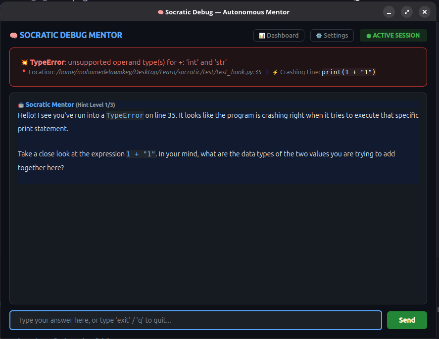

# 🧠 Socratic Debug (`socratic`)

> **Stop copying stack traces. Start mastering your bugs.**  
> An autonomous pedagogical debugger and AI mentor built for **students learning to code** and **developers** who want to truly understand their errors instead of copy-pasting AI patches.

[](https://github.com/mohamedelawakey/socratic/actions/workflows/ci.yml)
[](https://pypi.org/project/socratic-debug/)
[](https://www.python.org/)
[](LICENSE)  
[](https://www.langchain.com/)
[](https://langchain-ai.github.io/langgraph/)
[](https://riverbankcomputing.com/software/pyqt/)
[](https://github.com/Textualize/rich)

[📦 PyPI Package](https://pypi.org/project/socratic-debug/) • [🐛 Report Bug](https://github.com/mohamedelawakey/socratic/issues)

---

<p align="center">
  <a href="test/test_hook.py">
    
  </a>
  <br />
  <sub>⚡ <em>Interactive debugging session generated live from <a href="test/test_hook.py"><code>test/test_hook.py</code></a></em></sub>
</p>

---

## 💡 Why Socratic?

When a runtime crash happens, both beginners learning to program and seasoned developers often hit a wall:
1. **For Students & Beginners:** A 50-line red terminal traceback feels overwhelming and cryptic. In the age of AI, copying the error into an LLM and pasting the generated code creates an illusion of progress—the student passes the assignment but never builds problem-solving intuition or mental models.
2. **For Developers & Engineers:** Blindly pasting fixes without dissecting the failure mechanism leads to fragile code, cascading bugs, and recurring design flaws.

**Socratic Debug changes the paradigm.**  
Instead of dumping walls of red text or spoon-feeding copy-paste solutions, `socratic` intercepts uncaught runtime crashes and launches a **dedicated desktop mentorship window**. Powered by LangGraph, it acts like a personal coding instructor sitting right next to you:
- It guides you through a progressive, calibrated Socratic dialogue.
- It asks probing questions that help you spot the exact misconception on your own.
- It verifies your understanding before finally unlocking defensive programming best practices.

---

## ✨ Features

- 🖥️ **Standalone Desktop Window:** Launches an isolated, dark-themed GUI terminal window right at the center of your screen. No terminal clutter.
- ⚙️ **In-App Settings Drawer & Secret Masking:** Configure models and API keys directly from the GUI with a slide-in settings panel, toggleable secret masking (`👁️`), and instant hot-reloading.
- ⚡ **Real-Time Auto-Reload & Live Watcher:** Background file monitor (`FileMonitor`) listens for fixes as you edit your code. It handles editor auto-save with a smart typing debounce, validates syntax, and auto-detects solutions live—no manual re-runs needed!
- 🌍 **Pure Native BiDi & Arabic Support:** Flawlessly displays English and Arabic with full Right-to-Left (RTL) text shaping and formatting.
- 🎯 **Calibrated Socratic Mentorship:** 3-tier adaptive hints (Observation ➔ Mechanism ➔ Idiomatic Prevention).
- 🧠 **Smart Evaluator:** Distinguishes between partial observations (e.g., stating a variable's value) and true comprehension before unlocking the defensive code solution.
- 🔌 **Universal LLM Support:** Plug into local models via **Ollama** (Gemma, Llama, Qwen) or cloud providers via **OpenRouter** / **Google Gemini**.
- 🏗️ **Clean Decoupled Architecture:** Core agent nodes and exception hooks communicate via an abstract `EventBus`, allowing Socratic to plug cleanly into Desktop GUI, CLI, or future IDE plugins (VS Code, JetBrains).
- 📊 **Built-in Observability:** Native tracing with **LangSmith** to monitor latency, tokens, and node execution graphs.
- 🌐 **Cross-Platform:** Runs seamlessly on **Linux**, **macOS**, and **Windows**.

---

## 🚀 Quick Start

### Installation

The cleanest, recommended way to install `socratic` globally across your system without virtual environment conflicts:

```bash
# Recommended (isolated global CLI)
pipx install socratic-debug

# Or via standard pip
pip install socratic-debug
```

Alternatively, use the one-line install script:
```bash
# Linux & macOS
curl -sSL https://raw.githubusercontent.com/mohamedelawakey/socratic/main/install.sh | bash

# Windows (PowerShell)
irm https://raw.githubusercontent.com/mohamedelawakey/socratic/main/install.ps1 | iex
```

---

## 🛠️ Usage

You can use `socratic` in two distinct ways:

### Method 1: Zero-Code-Change CLI Runner (Recommended)
You don't need to add any code or imports to your script! Simply prefix your execution:

```bash
socratic run my_script.py
```
- If your script runs successfully, it outputs normally.
- If an unhandled exception occurs, the **Socratic Mentor Window** springs to life immediately!
- Edit your file in your editor (VS Code, PyCharm, etc.)—Socratic will detect your fix live and celebrate your solution!

### Method 2: In-Process Runtime Hook
If you are building an application or library and want Socratic guidance baked directly into development runs:

```python
import socratic
socratic.install()

# Your regular application code
number_1 = 10
number_2 = 0
print(number_1 / number_2)  # <-- ZeroDivisionError triggers Socratic window!
```

---

## ⚙️ Configuration (`.socratic.yaml`)

You can configure settings via the in-app **⚙️ Settings** drawer or directly in `.socratic.yaml`:

```yaml
# LLM Provider: "ollama" or "openrouter"
provider: "ollama"
provider_name: "gemma4:31b-cloud"
provider_link: "http://localhost:11434"

# API Key (for cloud providers like OpenRouter)
api_key: "your_api_key_here"

# Mentor Personality & Language ("Arabic" or "English")
socratic_language: "English"
socratic_style: "friendly"

# Observability with LangSmith (Optional)
LANGSMITH_TRACING: "true"
LANGSMITH_API_KEY: "lsv2_pt_..."
LANGSMITH_PROJECT: "socratic-debug"
```

---

## 🤝 Contributing
 
We welcome contributions from developers worldwide! Please review our [CONTRIBUTING.md](CONTRIBUTING.md) guidelines:
- For feature requests or major changes, **please open a GitHub Discussion or Issue first**.
- For bug fixes, direct Pull Requests are warmly welcome.
- Browse our open issues labeled `good first issue` to start contributing.

Please note that this project adheres to the [Contributor Covenant Code of Conduct](CODE_OF_CONDUCT.md).

---

## 📄 License

Distributed under the **MIT License**. See [LICENSE](LICENSE) for full details.
